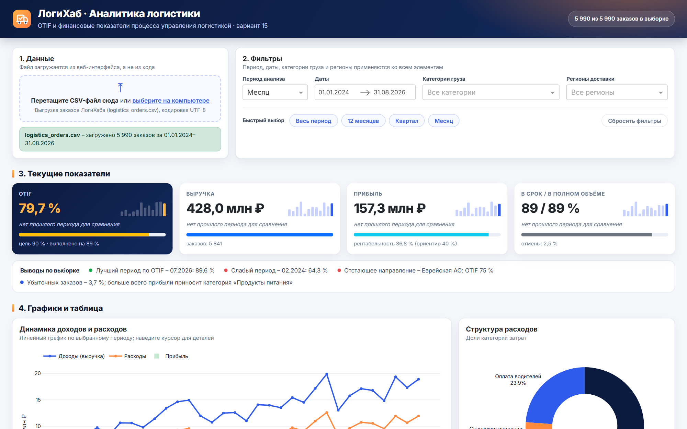
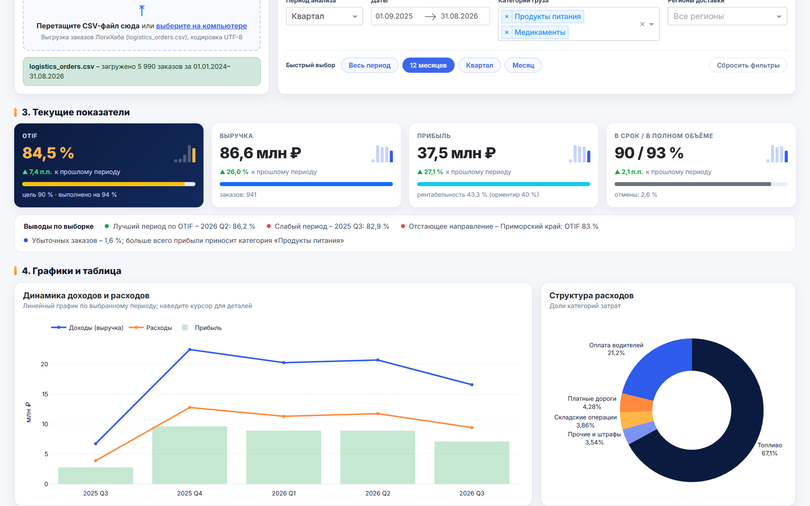
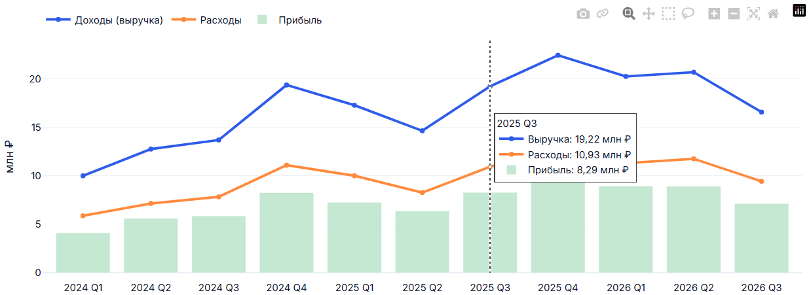
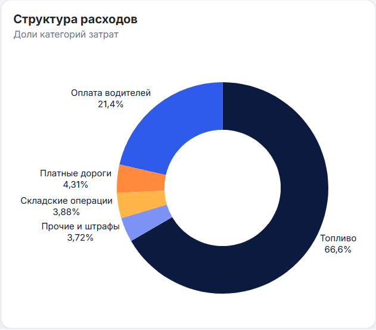
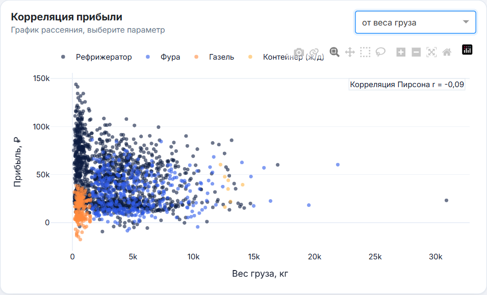
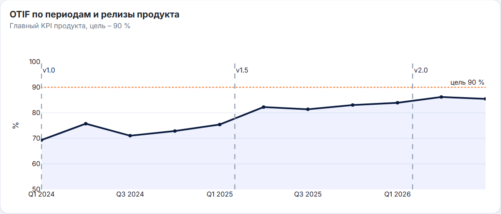
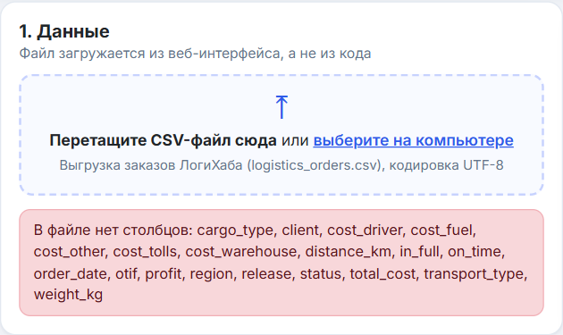

<div align="center">


# ЛогиХаб · аналитический дашборд

**Интерактивный дашборд OTIF и финансовых показателей процесса управления логистикой**

[](https://github.com/starpxand/logihub-dashboard/actions/workflows/ci.yml)


[](LICENSE)

[Wiki продукта](https://starpxand.github.io/logihub-wiki/) ·
[Telegram-бот](https://github.com/starpxand/logihub-telegram-bot) ·
[Инструкция](#как-пользоваться-дашбордом)



</div>

## О проекте

Дашборд – часть учебного цифрового продукта **«ЛогиХаб»** (вариант 15 «Процесс управления
логистикой»). Он визуализирует данные, которые формируются на последнем этапе
BPMN-процесса «Закрыть заказ и пересчитать OTIF»: выручку, расходы, прибыль и признаки
доставки «в срок» (On Time) и «в полном объёме» (In Full).

**Возможности**

- загрузка CSV-файла **из веб-интерфейса** (drag-and-drop или выбор файла) с проверкой формата;
- выбор периода анализа – **месяц / квартал / год** – и диапазона дат, быстрый выбор «весь период / 12 месяцев / квартал / месяц» и сброс фильтров;
- фильтрация по **категориям груза** и **регионам доставки**;
- 4 индикатора текущих значений с полосами прогресса (OTIF, выручка, прибыль, On Time / In Full), изменением к прошлому периоду той же длины (▲/▼) и мини-трендом;
- автоматические выводы по выборке: лучший и слабый период по OTIF, отстающее направление, доля убыточных заказов;
- перекрёстная фильтрация: щелчок по региону на графике фильтрует весь дашборд;
- плавный пересчёт: числа в карточках и графики перетекают к новым значениям;
- 6 интерактивных графиков с подсказками при наведении и таблица ключевых показателей.

## Состав дашборда

| № | Элемент | Тип | Что показывает |
|---|---|---|---|
| 1 | Загрузка данных | `dcc.Upload` | Загружает `logistics_orders.csv`, сообщает число заказов и период |
| 2 | Период анализа | `dcc.Dropdown` | Группировка данных: месяц, квартал, год |
| 3 | Даты, категории, регионы | `DatePickerRange`, `Dropdown` (multi), кнопки | Фильтры, применяемые ко всем элементам; быстрый выбор периода от последней даты в файле и «Сбросить фильтры» |
| 4 | Индикаторы | `dbc.Progress` | OTIF относительно цели 90 %, выручка, прибыль и рентабельность, доля доставок в срок и в полном объёме; изменение к прошлому периоду той же длины и мини-тренд по периодам |
| 4а | Выводы по выборке | текст | Лучший и слабый период по OTIF, отстающее направление, доля убыточных заказов |
| 5 | Динамика доходов и расходов | линейный график + столбцы | Выручка, расходы и прибыль по периодам |
| 6 | Структура расходов | круговая диаграмма | Доли топлива, оплаты водителей, складских операций, дорог, прочих затрат |
| 7 | Распределение прибыли | гистограмма | Распределение прибыли с заказа по типам транспорта, граница убытка |
| 8 | Корреляция прибыли | график рассеяния | Зависимость прибыли от расстояния, веса, выручки или расходов, коэффициент Пирсона |
| 9 | OTIF по периодам | график с областью | Главный KPI и отметки релизов v1.0, v1.5, v2.0 |
| 10 | Выручка по регионам | горизонтальные столбцы | Выручка и OTIF по направлениям; щелчок по столбцу добавляет регион в фильтр или снимает его |
| 11 | Ключевые показатели | `DataTable` | Заказы, выручка, расходы, прибыль, рентабельность, OTIF за каждый период |

## Установка и запуск

Нужен Python 3.11 или новее (проверено на 3.12 и 3.14).

```bash
git clone https://github.com/starpxand/logihub-dashboard.git
cd logihub-dashboard
python -m venv .venv
# Windows: .venv\Scripts\activate    Linux/macOS: source .venv/bin/activate
pip install -r requirements.txt
python app.py
```

Откройте <http://127.0.0.1:8050>. Переменные окружения: `HOST`, `PORT`, `DEBUG=1`.

Генерация нового набора тестовых данных:

```bash
python data/generate_data.py --seed 45 --out data/logistics_orders.csv
```

Тесты:

```bash
pip install pytest
pytest
```

## Как пользоваться дашбордом

1. **Загрузите данные.** Перетащите файл `data/logistics_orders.csv` в блок «1. Данные»
   или нажмите «выберите на компьютере». После проверки появится зелёное сообщение
   с числом заказов и периодом; при ошибке формата – красное сообщение со списком
   недостающих столбцов.
2. **Настройте фильтры** в блоке «2. Фильтры»: период группировки, даты, категории груза,
   регионы. Пустой фильтр означает «все значения». Кнопки «Весь период», «12 месяцев», «Квартал»,
   «Месяц» ставят диапазон дат от последней даты в файле; «Сбросить фильтры» возвращает весь период,
   все категории и регионы.
3. **Оцените текущие показатели** в блоке «3»: первая карточка – OTIF и степень выполнения
   цели 90 %. Под каждым значением – изменение к прошлому периоду той же длины (▲ рост, ▼ снижение),
   справа – мини-тренд; ниже – выводы по выборке.
4. **Исследуйте графики** в блоке «4»: наведите курсор для точных значений, выделите
   область мышью для масштабирования, двойной щелчок – сброс масштаба. На графике
   рассеяния выберите параметр в выпадающем списке справа. Щелчок по столбцу на графике
   «Выручка и OTIF по регионам» фильтрует весь дашборд по региону, повторный щелчок снимает фильтр.
5. **Сравните периоды** в таблице внизу: сортировка – по клику на заголовок столбца,
   OTIF ≥ 90 % подсвечивается зелёным, ниже 75 % – красным.

| Фильтрация по кварталам | Подсказка при наведении |
|---|---|
|  |  |
| **Структура расходов** | **Корреляция прибыли** |
|  |  |
| **OTIF и релизы** | **Проверка формата файла** |
|  |  |

## Использование как библиотеки

Модуль данных дашборда можно подключить к другим сервисам ЛогиХаба (например, к Telegram-боту):

```bash
pip install "logihub-dashboard @ git+https://github.com/starpxand/logihub-dashboard@v1.1.0"
```

```python
from logihub_dashboard.data import prepare, kpis, by_period
```

## Формат данных

CSV в UTF-8, одна строка – один заказ. Обязательные столбцы:

| Столбец | Описание |
|---|---|
| `order_id`, `order_date`, `release` | номер заказа, дата, релиз продукта |
| `client`, `region`, `cargo_type`, `transport_type` | клиент, регион, категория груза, тип транспорта |
| `distance_km`, `weight_kg` | расстояние и вес груза |
| `revenue`, `cost_fuel`, `cost_driver`, `cost_warehouse`, `cost_tolls`, `cost_other`, `total_cost`, `profit` | финансовые показатели, ₽ |
| `status`, `on_time`, `in_full`, `otif` | статус заказа и признаки OTIF (0/1) |

## Структура репозитория

```text
logihub-dashboard/
├── app.py                     # точка входа Dash
├── pyproject.toml             # пакет logihub-dashboard (подключается к Telegram-боту)
├── requirements.txt           # зависимости
├── logihub_dashboard/
│   ├── data.py                # загрузка, проверка, агрегирование
│   ├── figures.py             # графики Plotly
│   ├── layout.py              # разметка страницы
│   └── callbacks.py           # интерактивность, сравнение периодов, перекрёстная фильтрация
├── assets/                    # стили, логотип, kpi.js – плавный пересчёт чисел
├── data/                      # генератор и тестовая выгрузка заказов
├── tests/                     # pytest
├── docs/screenshots/          # изображения для документации
├── .github/workflows/ci.yml   # GitHub Actions: тесты при каждом push
└── LICENSE                    # лицензия MIT
```

## Ветки и процесс разработки

| Ветка | Назначение |
|---|---|
| `main` | релизная ветка, стабильные версии (теги `v1.0.0` – дашборд, `v1.1.0` – пакет для Telegram-бота, `v1.2.0` – сравнение периодов и выводы) |
| `develop` | тестовая ветка, интеграция функциональности |
| `feature/*` | разработка отдельных возможностей с последующим слиянием в `develop` |

## Автор

**Попов А.С.**, группа 5ИТб-2, ФГБОУ ВО «КнАГУ» · GitHub: [@starpxand](https://github.com/starpxand)

Лицензия – [MIT](LICENSE).
